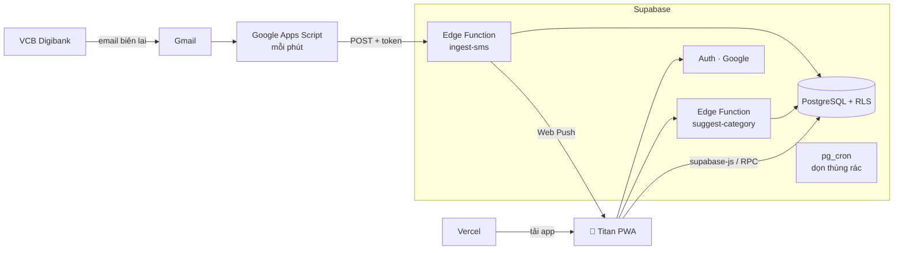

# Titan


**Ti**êu + Di**tan** — web app (PWA) quản lý chi tiêu cá nhân **tự động**, dùng trên iPhone như app thật.

- 📧 **Tự ghi giao dịch VCB** từ email biên lai miễn phí của VCB Digibank: đăng nhập Google, cho phép đọc Gmail là xong (v1.3), ~1–2 phút sau khi chuyển khoản
- 🏷️ **Tự gợi ý danh mục**: ghi nhớ thói quen của bạn theo từng quán → từ điển từ khóa → (tùy chọn) Claude AI
- 📥 **Duyệt bằng cách vuốt**: phải = đúng · trái = sửa · lên = không phải chi tiêu (chuyển khoản, trả nợ, thu nợ…)
- ✍️ **Ghi nhanh tiền mặt** bằng một dòng: `bánh mì: 20k; trà sữa: 45k`, lệnh `/hôm qua`, `/ngày 03/11`, `/vcb`, `/thu`, `@Minh` (được trả hộ)
- 🗓️ **Kế hoạch tháng** (v1.1): khoản cố định tự cấu hình · tiết kiệm trước · **"Hôm nay còn được tiêu"** chia theo kiểu ngày (ở nhà / bình thường / đi ăn sang / tiệc) · hũ dư · ngân sách danh mục · quỹ kiểu MoMo
- 🌙 **Tổng kết cuối ngày** (v1.2): đếm tờ tiền trong ví để đối soát, đối soát số dư VCB · thông báo 20:00 và nhắc khoản cố định đến hạn · 🎬 **Recap tháng** kiểu story
- 🏠 **Giao diện mới** (v1.3): Trang chủ một màn với tab VCB (duyệt ngay) / Tiền mặt (chiếc ví vẽ đúng các tờ đang có) · ghi tiền đưa / tiền thối · trang Giao dịch lọc theo ngày / tháng / năm · kiểu ngày tùy chỉnh · thiết lập từng bước
- 🔁 Nhận diện **chuyển tiền giữa các tài khoản của chính mình** — không tính vào thu chi
- 🔔 Thông báo đẩy trên iPhone · 🗑️ Thùng rác 30 ngày · 💸 Chi phí vận hành **0đ**

> **v1.3 – Giao diện mới, tự đọc Gmail** ([ghi chú phát hành](docs/releases/v1.3.0.md), [1.3.1](docs/releases/v1.3.1.md)). Thiết kế ở [docs/07](docs/07-v1.1-ke-hoach-chi-tieu.md), [docs/08](docs/08-v1.2-tong-ket-doi-soat.md), [docs/09](docs/09-v1.3-giao-dien-moi.md) và [BRD mục 11](docs/01-dac-ta-nghiep-vu.md#11-danh-sách-tính-năng-và-lộ-trình).

## Kiến trúc



| Lớp | Công nghệ |
|---|---|
| Frontend | React 19 · Vite · TypeScript · Tailwind CSS · TanStack Query · vite-plugin-pwa (Workbox) |
| Backend | Supabase: PostgreSQL (RLS, RPC, view) · Auth Google · Edge Functions (Deno) · pg_cron |
| Tích hợp | Google Apps Script (Gmail) · Web Push (VAPID) · Claude API (tùy chọn) |
| Hạ tầng | Vercel · Supabase Cloud · GitHub Actions |

**Nguyên tắc thiết kế**
- **Hàm thuần ở `supabase/functions/_shared/`** (bộ tách email/SMS, bộ tách ghi nhanh, từ điển, gợi ý danh mục) — dùng chung cho Edge Functions và trình duyệt, test bằng Vitest.
- **Tiền là `bigint` đồng**, số dư **tính từ lịch sử** (view `wallet_balances`) nên không bao giờ lệch.
- **Nghiệp vụ nhiều bước là RPC atomic** (`confirm_transaction` duyệt + học ghi nhớ quán trong một transaction).
- **Dữ liệu nhạy cảm tối thiểu**: che số tài khoản trước khi lưu, token chỉ lưu bản băm, AI chỉ nhận mô tả + số tiền.

## Tài liệu
| # | Tài liệu |
|---|---|
| 01 | [Đặc tả nghiệp vụ (BRD)](docs/01-dac-ta-nghiep-vu.md) |
| 02 | [Kế hoạch kỹ thuật](docs/02-ke-hoach-ky-thuat.md) |
| 03 | [Cài đặt tài khoản](docs/03-cai-dat-tai-khoan.md) |
| 04 | [Kết nối Gmail để tự ghi giao dịch](docs/04-ket-noi-gmail.md) |
| 05 | [Checklist kiểm thử v1.0](docs/05-kiem-thu-v1.md) |
| 06 | [Thiết kế giao diện](docs/06-thiet-ke-giao-dien.md) |
| 07 | [v1.1 – Kế hoạch chi tiêu](docs/07-v1.1-ke-hoach-chi-tieu.md) |
| 08 | [v1.2 – Tổng kết, đối soát, recap](docs/08-v1.2-tong-ket-doi-soat.md) |
| 09 | [v1.3 – Giao diện mới, tự đọc Gmail](docs/09-v1.3-giao-dien-moi.md) |
| — | [Ghi chú phát hành](docs/releases/) |

## Chạy local

Cần: Node 24, pnpm, Docker Desktop, Supabase CLI.

```bash
pnpm install
cp supabase/.env.example supabase/.env                      # Google OAuth client (đăng nhập local)
cp supabase/functions/.env.example supabase/functions/.env  # khóa VAPID, (tùy chọn) ANTHROPIC_API_KEY
pnpm db:start                                               # Supabase local (Docker)
cp apps/web/.env.example apps/web/.env.local                # điền key từ `supabase status`
pnpm dev                                                    # http://localhost:5173
pnpm functions:serve                                        # (terminal khác) Edge Functions local
```

## Kiểm thử

```bash
pnpm typecheck && pnpm lint && pnpm test   # TypeScript, lint, 188 unit test
pnpm test:db                               # 12 file test database: RLS, số dư, ghi nhớ quán, bảo mật
pnpm test:ingest                           # 34 kiểm tra tích hợp API nhận email/SMS
```

CI (GitHub Actions) chạy typecheck, lint, unit test mỗi lần push.

## Triển khai

```bash
supabase db push --remote                               # migration
supabase functions deploy ingest-sms --no-verify-jwt    # xác thực bằng token riêng
supabase functions deploy suggest-category
supabase functions deploy push-test
supabase functions deploy cron-notify --no-verify-jwt   # xác thực bằng CRON_SECRET
supabase functions deploy gmail-poll --no-verify-jwt    # pg_cron mỗi phút, xác thực bằng CRON_SECRET
supabase functions deploy gmail-connect                 # JWT người dùng
supabase functions deploy push-subscribe                # JWT người dùng, đăng ký thông báo của thiết bị
```
Đọc Gmail (v1.3) cần thêm secret `GOOGLE_CLIENT_ID`, `GOOGLE_CLIENT_SECRET`, `GMAIL_TOKEN_KEY` và bật Gmail API trên Google Cloud, xem [docs/04](docs/04-ket-noi-gmail.md).
Thông báo hẹn giờ (v1.2) cần thêm secret `CRON_SECRET` cho Edge Functions và 2 secret trong Vault (`titan_functions_url`, `titan_cron_secret`) để pg_cron gọi được `cron-notify`, xem [docs/08](docs/08-v1.2-tong-ket-doi-soat.md).

Web: push lên `main` → Vercel tự deploy. Icon: sửa `apps/web/icons/icon.svg` rồi `pnpm icons`.

## Cấu trúc

```
apps/web/                   React PWA (features/: home, review, quick-entry, onboarding, settings)
supabase/migrations/        schema, RLS, RPC, cron
supabase/functions/         Edge Functions · _shared (hàm thuần + test) · _lib (Deno: push, AI, crypto)
supabase/tests/             test SQL
integrations/gmail-apps-script/  script đọc Gmail
scripts/                    test-db, test-ingest, make-icons
docs/                       tài liệu
```
