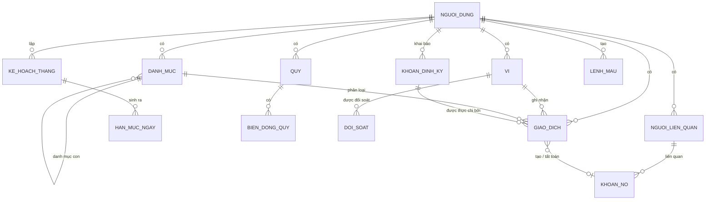
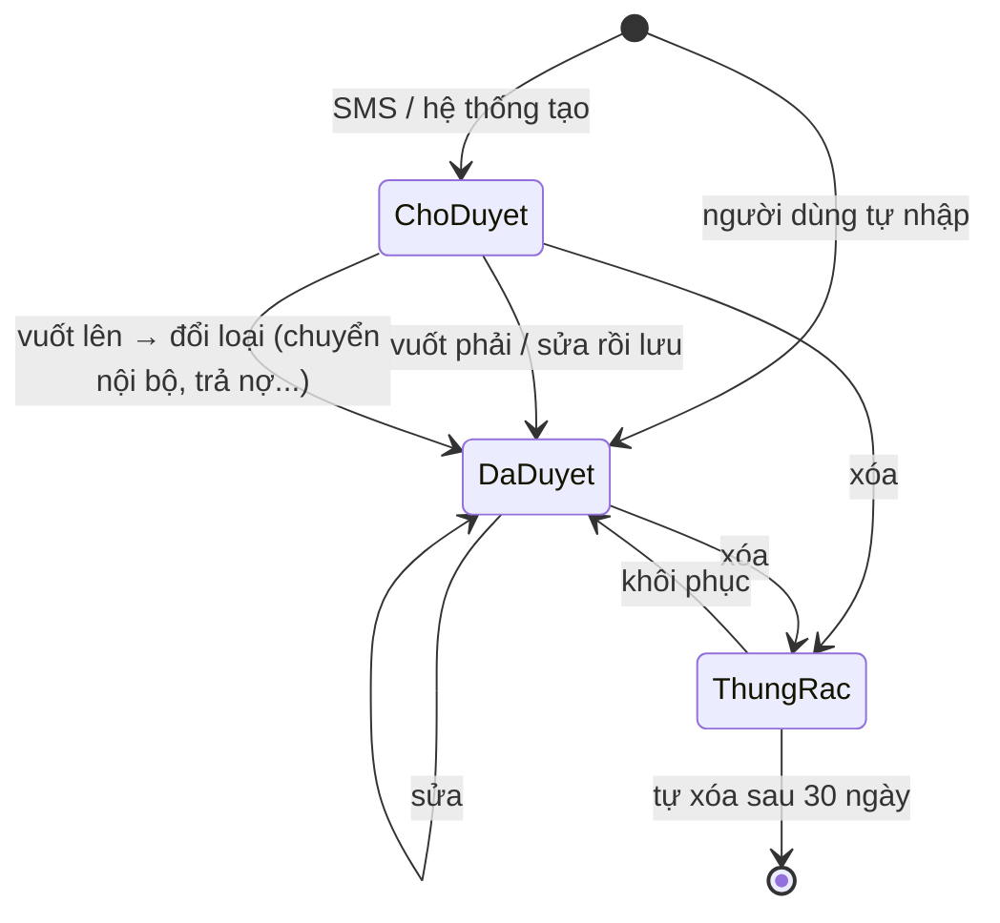
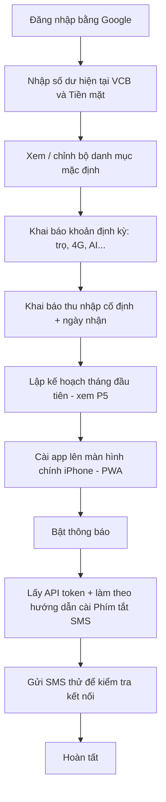
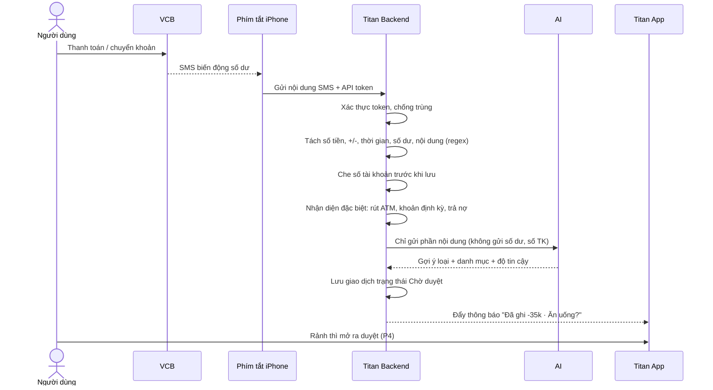
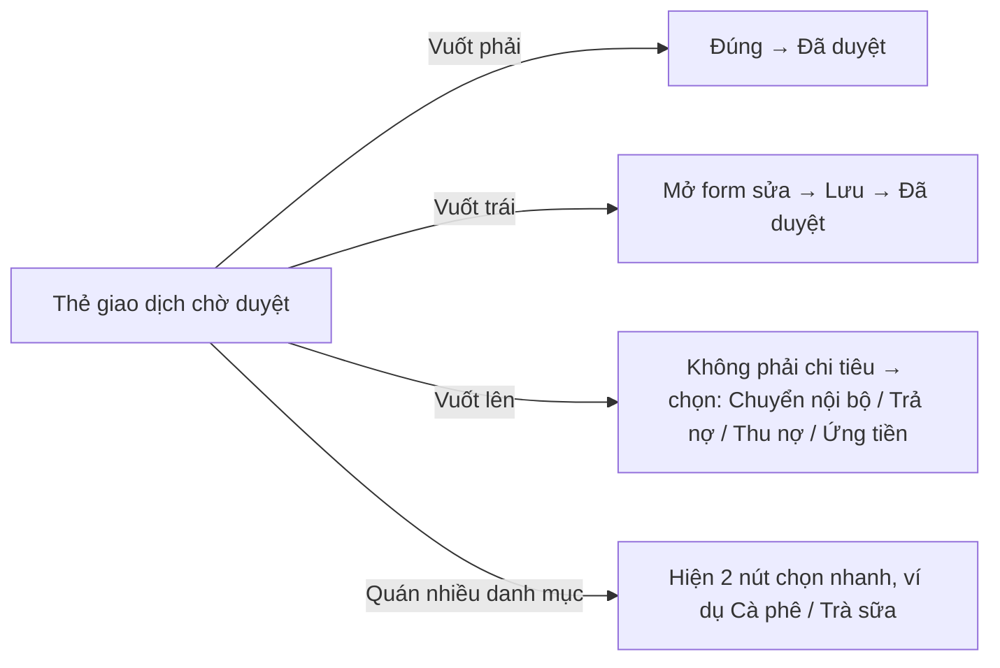
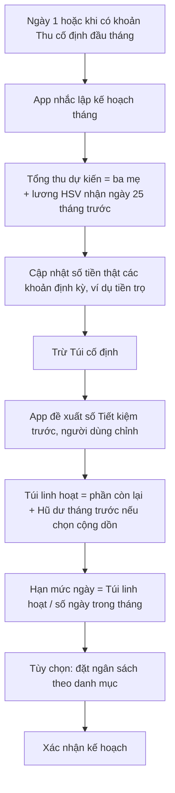
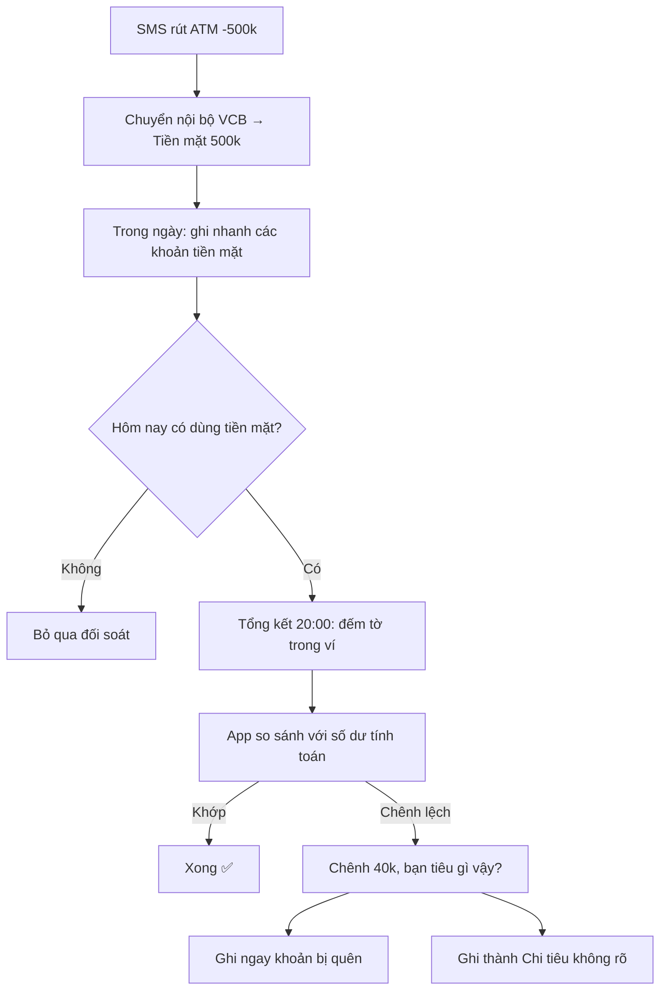

# TITAN – Tài liệu Đặc tả Nghiệp vụ (BRD)

| | |
|---|---|
| **Sản phẩm** | Titan – Web app quản lý chi tiêu cá nhân tự động |
| **Phiên bản tài liệu** | 1.0 |
| **Ngày** | 06/11/2026 |
| **Khách hàng / Người dùng đầu tiên** | ditan |
| **Giai đoạn dự án** | Phân tích nghiệp vụ (đã xong thu thập yêu cầu qua 5 vòng phỏng vấn) |
| **Bước tiếp theo** | Khách hàng duyệt tài liệu → Lên kế hoạch kỹ thuật |

> Tên **Titan** = **Ti** (trong "tiêu") + **Tan** (trong "ditan").

---

## Mục lục

1. [Tổng quan](#1-tổng-quan)
2. [Các quyết định đã chốt](#2-các-quyết-định-đã-chốt)
3. [Thuật ngữ](#3-thuật-ngữ)
4. [Phương pháp quản lý chi tiêu áp dụng](#4-phương-pháp-quản-lý-chi-tiêu-áp-dụng)
5. [Đối tượng nghiệp vụ](#5-đối-tượng-nghiệp-vụ)
6. [Quy trình nghiệp vụ](#6-quy-trình-nghiệp-vụ)
7. [Quy tắc nghiệp vụ](#7-quy-tắc-nghiệp-vụ)
8. [Màn hình chính, thống kê, recap](#8-màn-hình-chính-thống-kê-recap)
9. [Thông báo](#9-thông-báo)
10. [Yêu cầu phi chức năng](#10-yêu-cầu-phi-chức-năng)
11. [Danh sách tính năng và lộ trình](#11-danh-sách-tính-năng-và-lộ-trình)
12. [Giả định, rủi ro, vấn đề còn mở](#12-giả-định-rủi-ro-vấn-đề-còn-mở)
13. [Phụ lục: Ngân sách mẫu](#13-phụ-lục-ngân-sách-mẫu)

---

## 1. Tổng quan

### 1.1. Bối cảnh

Người dùng từng ghi chi tiêu trên Google Sheet nhưng bỏ sau 1–2 tháng vì:

- **Lười ghi**: phải tự nhập tay, cuối ngày mới nhập nên quên mất khoản tiền đã tiêu vào việc gì.
- **Không có dashboard**: chỉ xem được bảng tính, không có thống kê trực quan, nhiều góc nhìn.
- **Không dùng tiện trên điện thoại**.

### 1.2. Mục tiêu sản phẩm (theo thứ tự ưu tiên)

| # | Mục tiêu | Đo bằng |
|---|---|---|
| G1 | **Nhìn thấy dòng tiền**: biết tiền đi đâu | ≥ 90% giao dịch chuyển khoản được ghi tự động, không cần gõ tay |
| G2 | **Điều chỉnh hành vi**: bớt tiêu vặt (trà sữa, ăn ngoài) | Chi tiêu linh hoạt không vượt hạn mức tháng |
| G3 | **Tiết kiệm có mục tiêu**: quỹ dự phòng + quỹ MacBook | Mỗi tháng đều trích được tiền vào quỹ |
| G4 | **Duy trì thói quen** | Dùng liên tục > 3 tháng (vượt mốc bỏ cuộc của Google Sheet) |

### 1.3. Người dùng

- **Bản đầu tiên:** chỉ một người dùng (ditan): sinh viên, dùng iPhone, tài khoản Vietcombank (VCB) và tiền mặt.
- **Tương lai:** mở cho nhiều người, mỗi người một tài khoản với dữ liệu riêng biệt. Hệ thống phải thiết kế **đa người dùng ngay từ đầu**.

### 1.4. Bức tranh tài chính của người dùng đầu tiên

| Loại | Chi tiết | Tính chất |
|---|---|---|
| Thu cố định | Gia đình gửi (đầu tháng), lương / phụ cấp (ngày 25) | Hằng tháng |
| Thu không cố định | Học bổng, tiền được cho | Thỉnh thoảng |
| Chi cố định | Tiền trọ, các gói AI (ChatGPT, Claude), 4G, gói thành viên (Shopee VIP, Grab Unlimited) | Hằng tháng |
| Chi biến đổi | Ăn uống, trà sữa, ăn ngoài, sinh hoạt, xăng | Hằng ngày, **cần kiểm soát** |
| Nguồn tiền | 1 tài khoản VCB (~80% giao dịch) + tiền mặt (~20%) | MoMo chỉ dùng như cổng thanh toán liên kết VCB |

### 1.5. Phạm vi

**Trong phạm vi:**
- Ghi nhận thu chi tự động (SMS Banking VCB) và thủ công (tiền mặt).
- Kế hoạch tháng: túi cố định, tiết kiệm trước, hạn mức ngày.
- Sổ nợ, các quỹ tiết kiệm, đối soát tiền mặt.
- Thống kê, recap tháng, xuất Excel.
- AI cơ bản (phân loại danh mục), sau này AI nâng cao (hỏi đáp, dự báo...).

**Ngoài phạm vi (ít nhất ở giai đoạn 1):**
- Kết nối trực tiếp với ngân hàng hoặc dịch vụ trung gian bên thứ ba (Casso, SePay...).
- Nhiều tài khoản ngân hàng, nhiều ví điện tử, thẻ tín dụng.
- Ngoại tệ, đa ngôn ngữ, chế độ tối.
- Linh vật (tạm hoãn, chưa chọn được).
- Thu phí người dùng.

---

## 2. Các quyết định đã chốt

| # | Chủ đề | Quyết định | Lý do |
|---|---|---|---|
| D1 | Nền tảng | **Giai đoạn 1:** Backend + Web PWA (mobile-first, có dashboard máy tính). **Giai đoạn 2:** app iOS native "vệ tinh" cho widget và thông báo, dùng lại backend. | Phần tự động nằm ở backend; đúng mục tiêu học web; chi phí 0đ; mở rộng được |
| D2 | Ghi tự động | ~~SMS Banking + Phím tắt~~ → **(07/11/2026) Email biên lai VCB Digibank + Google Apps Script** gửi nội dung tới API của Titan. SMS vẫn được hỗ trợ nếu đăng ký sau | 0đ (SMS Banking tốn phí hằng tháng), chạy trên máy chủ Google nên iPhone tắt vẫn ghi, có số lệnh giao dịch để chống trùng tuyệt đối. Đánh đổi: không có số dư, trễ ~1–2 phút |
| D3 | Nguồn tiền | Chỉ **VCB + Tiền mặt**. Nhận tiền bằng số tài khoản / VietQR VCB, hạn chế nhận qua MoMo | Gom mọi dòng tiền về một chỗ để ghi tự động được |
| D4 | Ghi tay | **Chỉ bằng text**, không dùng giọng nói. Cú pháp `món: giá; món: giá`, có **lệnh "/"** và hàng nút chọn nhanh | Có cấu trúc → tách được không cần AI, nhanh, offline |
| D5 | Duyệt giao dịch | Vuốt kiểu thẻ: **phải = đúng, trái = sửa, lên = không phải chi tiêu** | Duyệt nhanh, giảm "lười" |
| D6 | Phương pháp | **Phong bì + Tiết kiệm trước**, hạn mức ngày reset mỗi ngày, phần chênh lệch vào **Hũ dư** | Xem mục 4 |
| D7 | Vai trò AI | **AI chỉ đề xuất, người dùng quyết định.** Mọi đề xuất có nút hành động | Người dùng giữ quyền kiểm soát dữ liệu tài chính |
| D8 | Đăng nhập | Chỉ **Google** | Đơn giản, không phải quản lý mật khẩu |
| D9 | Giao diện | Tối giản, **không có chế độ tối**, chỉ tiếng Việt, chỉ VND, **chưa có linh vật** | Theo sở thích khách hàng |
| D10 | Ưu tiên | **Bắt buộc ở v1: tự đọc giao dịch → tự ghi.** AI nâng cao để sau | Đây là thứ giải quyết vấn đề "lười ghi" |
| D11 | Phân loại | **(07/11/2026) Không dùng AI trả phí ở v1.** Gợi ý danh mục = ghi nhớ quán → từ điển từ khóa (miễn phí); người dùng chọn khi duyệt. Code AI giữ sẵn, tự bật khi đặt `ANTHROPIC_API_KEY` | Khách hàng chưa muốn trả phí; phân loại không phải tính năng sống còn |

---

## 3. Thuật ngữ

| Thuật ngữ | Định nghĩa |
|---|---|
| **Ví** | Nơi chứa tiền thật. Có 2 ví: **VCB** và **Tiền mặt**. |
| **Giao dịch** | Một lần tiền thay đổi (hoặc phát sinh nghĩa vụ nợ). Có 6 loại, xem mục 5.3. |
| **Chờ duyệt** | Giao dịch do hệ thống/AI tạo ra, người dùng chưa xác nhận. Vẫn được tính vào thống kê nhưng đánh dấu ⚠️. |
| **Kế hoạch tháng** | Bản phân bổ tiền của một tháng tài chính (từ ngày 1 tới cuối tháng) vào 3 túi. |
| **Túi cố định** | Tiền giữ riêng cho các khoản chi định kỳ đã biết trước. Chỉ trừ khi thực chi. |
| **Tiết kiệm trước** | Tiền trích vào quỹ ngay khi lập kế hoạch tháng, trước khi tiêu. |
| **Túi linh hoạt** | Phần còn lại để tiêu hằng ngày, chia thành **hạn mức ngày**. |
| **Hạn mức ngày** | Số tiền được tiêu linh hoạt trong một ngày. Reset mỗi ngày. |
| **Hũ dư** | Nơi cộng dồn chênh lệch (hạn mức ngày − chi linh hoạt thực tế) trong tháng. Có thể âm. |
| **Quỹ** | Quỹ ảo (tiền vẫn nằm trong VCB), ví dụ Quỹ dự phòng, Quỹ MacBook. |
| **Sổ nợ** | Danh sách khoản mình nợ người khác và người khác nợ mình. |
| **Đối soát tiền mặt** | So sánh tiền mặt thực tế trong ví (người dùng đếm) với số app tính. |
| **Tổng kết 20:00** | Màn hình cuối ngày: duyệt giao dịch chờ + đối soát tiền mặt. Giờ do người dùng cài. |
| **Lệnh "/"** | Tiền tố khi ghi nhanh để chỉ định ngữ cảnh (ngày, người trả hộ, mẫu). |
| **Lệnh mẫu** | Lệnh "/" do người dùng tự tạo cho khoản lặp lại, ví dụ `/xăng`. |
| **Ghi nhớ quán** | Dữ liệu AI học được về việc một quán/nội dung thường thuộc danh mục nào. |

---

## 4. Phương pháp quản lý chi tiêu áp dụng

**Nguyên tắc: mỗi đồng tiền vào đều được giao nhiệm vụ ngay từ đầu tháng.**

```
💰 Thu nhập tháng (ba mẹ đầu tháng + lương HSV ngày 25 tháng trước)
        │
        ▼
① 📦 TÚI CỐ ĐỊNH       Trọ, 4G, ChatGPT, Claude, Shopee VIP, Grab Unlimited
        │               Giữ riêng, chỉ trừ khi thực chi
        ▼
② 🛟 TIẾT KIỆM TRƯỚC   Trích vào Quỹ dự phòng (số cố định mỗi tháng)
        │
        ▼
③ 👛 TÚI LINH HOẠT      Phần còn lại → chia đều ra HẠN MỨC NGÀY
                        (có thể đặt thêm ngân sách tháng cho từng danh mục)
```

**Hũ dư:**
- Mỗi ngày bắt đầu với hạn mức mới (reset).
- Cuối ngày: **dư thì cộng vào hũ**, **lố thì trừ từ hũ**.
- Cuối tháng: nếu hũ dương, app **đưa lựa chọn**: bỏ vào Quỹ MacBook / bỏ vào Quỹ dự phòng / cộng vào tháng sau. Người dùng quyết.

```
Hạn mức: 97k/ngày
T2: tiêu 90k   → hũ +7k    (hũ: 7k)
T3: tiêu 150k  → hũ −53k   (hũ: −46k)
T4: tiêu 60k   → hũ +37k   (hũ: −9k)
```

**Ba nguyên tắc vàng:**
1. Tiết kiệm trước, tiêu sau.
2. Nhìn con số "được tiêu hôm nay", đừng nhìn số dư tài khoản.
3. Xem lại hằng ngày, điều chỉnh hằng tháng.

---

## 5. Đối tượng nghiệp vụ

> Đây là mô hình **nghiệp vụ**, chưa phải thiết kế database. Thiết kế kỹ thuật sẽ làm ở giai đoạn lên kế hoạch code.



### 5.1. Người dùng
Tài khoản Google, tên, ảnh đại diện, **API token** dùng cho Phím tắt (xem lại / tạo lại được), các cài đặt (giờ tổng kết, giờ yên lặng, giọng điệu AI, khóa Face ID, ẩn số dư, số ngày nhắc trước khoản định kỳ).

### 5.2. Ví
| Thuộc tính | Ghi chú |
|---|---|
| Tên | VCB / Tiền mặt |
| Loại | Ngân hàng / Tiền mặt |
| Số dư ban đầu | Nhập khi thiết lập lần đầu (bắt đầu từ 0, không nhập dữ liệu cũ) |
| Số dư hiện tại | Hệ thống tính = số dư ban đầu + tổng biến động |

### 5.3. Giao dịch

**6 loại giao dịch:**

| Loại | Ví dụ | Ví thay đổi? | Tính vào chi tiêu/thu nhập? |
|---|---|---|---|
| **Chi** | Ăn trưa, đổ xăng, tiền trọ | ✅ Giảm | ✅ Chi tiêu |
| **Thu** | Ba mẹ gửi, lương, học bổng, bán đồ cũ | ✅ Tăng | ✅ Thu nhập |
| **Chuyển nội bộ** | Rút ATM (VCB → Tiền mặt), nạp tiền mặt vào VCB | ✅ Một ví giảm, một ví tăng | ❌ |
| **Được trả hộ** | Bạn Minh trả tiền cơm giùm | ❌ Không đổi | ✅ Chi tiêu (theo danh mục) + phát sinh **mình nợ** |
| **Cho vay / Ứng tiền** | Trả cho cả nhóm, ứng tiền cho Hội SV | ✅ Giảm | ❌ Phát sinh **người khác nợ mình** |
| **Trả nợ / Thu nợ** | Chuyển lại cho Minh, Hội hoàn tiền | ✅ Giảm / Tăng | ❌ Tất toán khoản nợ |

**Thuộc tính bắt buộc:** loại, số tiền (VND, > 0), thời gian, ví (trừ loại "Được trả hộ"), danh mục (chỉ với Chi, Thu, Được trả hộ), trạng thái (*Chờ duyệt / Đã duyệt*), nguồn ghi nhận (*SMS / Nhập tay / Đối soát / Hệ thống*, tự điền).

**Thuộc tính tùy chọn:** ghi chú, tên quán/địa điểm, ảnh hóa đơn, người liên quan (**bắt buộc** với Được trả hộ, Cho vay/Ứng, Trả/Thu nợ), tag tự do (#hẹnhò, #hộiSV...), cảm xúc (*Đáng tiền / Bình thường / Hối hận*), liên kết khoản định kỳ, nội dung SMS gốc (hệ thống lưu, đã che số tài khoản), cờ "chưa chắc chắn".

**Vòng đời:**


### 5.4. Danh mục
2 cấp, có sẵn bộ mặc định, người dùng **tạo / sửa / ẩn** được. Mỗi danh mục thuộc nhóm **Chi** hoặc **Thu**.

**Bộ mặc định – Chi:**
| Danh mục | Danh mục con |
|---|---|
| 🍜 Ăn uống | Ăn chính, Ăn vặt, Trà sữa/Cà phê, Đi chợ |
| 🏠 Nhà ở | Tiền trọ, Điện nước, Đồ dùng |
| 🛵 Đi lại | Xăng, Gửi xe, Grab, Sửa xe |
| 📱 Hóa đơn & dịch vụ | 4G, ChatGPT, Claude, Shopee VIP, Grab Unlimited |
| 🎓 Học tập | Sách, Khóa học, Photo tài liệu |
| 🎉 Giải trí & xã hội | Đi chơi, Hẹn hò, Mừng cưới, Quà tặng, Quỹ lớp |
| 🛍️ Mua sắm | Quần áo, Đồ công nghệ, Đồ dùng hằng ngày |
| 💊 Sức khỏe | Thuốc, Khám bệnh |
| ❓ Chi tiêu không rõ | (dùng cho chênh lệch đối soát) |

**Bộ mặc định – Thu:** Gia đình gửi, Lương, Học bổng, Được cho/tặng, Bán đồ cũ, Thu khác.

### 5.5. Khoản định kỳ (Túi cố định)
| Thuộc tính | Ghi chú |
|---|---|
| Tên, danh mục | Ví dụ: Tiền trọ – Nhà ở/Tiền trọ |
| Số tiền dự kiến | Tiền trọ thay đổi theo tháng → cập nhật số thật khi chủ nhà báo |
| Ngày đến hạn | Ví dụ: ngày 5 hằng tháng |
| Ví thường dùng | Có thể thay đổi mỗi tháng (tiền trọ khi CK, khi tiền mặt) |
| Từ khóa nhận diện SMS | Ví dụ: "OPENAI", "ANTHROPIC", "GRAB" → giúp tự khớp |
| Nhắc trước | Mặc định 3 ngày, cấu hình được |
| Trạng thái trong tháng | *Chưa chi / Đã chi* (liên kết tới giao dịch thực chi) |

### 5.6. Kế hoạch tháng
Tháng tài chính = **từ ngày 1 tới ngày cuối tháng**. Gồm: tổng thu dự kiến, tổng túi cố định, số tiết kiệm trước, túi linh hoạt, hạn mức ngày, ngân sách theo danh mục (tùy chọn), số dư Hũ dư.

### 5.7. Quỹ
Quỹ ảo, tiền nằm trong VCB. Thuộc tính: tên, số mục tiêu (tùy chọn), hạn (tùy chọn), số hiện có, lịch sử biến động (nộp vào / rút ra, kèm lý do). Mặc định có **Quỹ dự phòng** và **Quỹ MacBook**.

### 5.8. Người liên quan và Khoản nợ
- **Người liên quan:** tên (ví dụ Minh, Hội SV), ghi chú.
- **Khoản nợ:** chiều (*Mình nợ / Nợ mình*), người liên quan, số tiền gốc, số đã trả, trạng thái (*Còn nợ / Đã tất toán*), giao dịch tạo ra, các giao dịch tất toán (cho phép trả nhiều lần).

### 5.9. Đối soát tiền mặt
Ngày, số dư app tính, số tiền đếm thực tế (nhập theo **số tờ từng mệnh giá**), chênh lệch, cách xử lý chênh lệch.

Mệnh giá: 500k, 200k, 100k, 50k, 20k, 10k, 5k, 2k, 1k.

### 5.10. Lệnh mẫu
Tên lệnh (ví dụ `xăng`), mô tả mặc định, số tiền mặc định, danh mục, ví.

### 5.11. Ghi nhớ quán
Từ khóa (tên quán / nội dung chuyển khoản đã chuẩn hóa) → phân bố danh mục người dùng đã xác nhận (ví dụ *Phúc Long → Cà phê 60%, Trà sữa 40%*).

---

## 6. Quy trình nghiệp vụ

### P1. Thiết lập ban đầu (lần đầu sử dụng)



### P2. Tự động ghi từ SMS Banking ⭐ (tính năng cốt lõi)



**Thứ tự nhận diện** (dừng ở bước đầu tiên khớp):
1. **Trùng lặp:** SMS đã nhận rồi → bỏ qua (BR-06).
2. **Rút ATM** → Chuyển nội bộ VCB → Tiền mặt (BR-10).
3. **Khoản định kỳ:** khớp từ khóa + số tiền gần đúng → Chi, liên kết khoản định kỳ.
4. **Trả nợ / thu nợ:** có khoản nợ đang mở với số tiền khớp hoặc tên người nhận khớp → gợi ý "Đây là trả nợ Minh 80k?".
5. **Ghi nhớ quán:** từ khóa đã có lịch sử → dùng danh mục đã học.
6. **AI phân loại.**
7. **Không xác định được** (ví dụ "MBVCB.123456.chuyen tien") → Chờ duyệt, danh mục để trống, gắn cờ cần bổ sung.

**Tiền vào (+):** mặc định gợi ý là **Thu**, AI phân loại nguồn. Nếu khớp khoản "người khác nợ mình" → gợi ý **Thu nợ**.

### P3. Ghi nhanh thủ công

**Cú pháp cơ bản:** `món: giá; món: giá; ...`

| Cách viết tiền được chấp nhận | Hiểu là |
|---|---|
| `20k`, `20K` | 20.000 |
| `20000`, `20.000` | 20.000 |
| `1tr2`, `1.2tr`, `1tr200` | 1.200.000 |

**Lệnh "/" và hàng nút chọn nhanh** (trên điện thoại bấm nút, trên laptop gõ lệnh):

| Lệnh | Ý nghĩa | Ví dụ |
|---|---|---|
| *(không có lệnh)* | Hôm nay, ví Tiền mặt | `bánh mì: 20k; mì tôm: 12k` |
| `/hôm qua` | Ghi lùi 1 ngày | `/hôm qua đổ xăng: 50k` |
| `/ngày dd/mm` | Ghi vào ngày cụ thể | `/ngày 03/11 cơm: 35k` |
| `/vcb` | Ghi cho ví VCB thay vì Tiền mặt | `/vcb sách: 120k` |
| `/thu` | Ghi khoản thu | `/thu bán đồ cũ: 200k` |
| `@tên` | Người khác trả hộ | `@Minh cơm tấm: 35k` |
| `/cho vay @tên` | Mình trả hộ / cho vay | `/cho vay @Lan trà sữa: 45k` |
| `/ứng @Hội SV` | Ứng tiền cho Hội | `/ứng @Hội SV in banner: 300k` |
| `/<lệnh mẫu>` | Dùng lệnh mẫu người dùng tạo | `/xăng`, `/xăng 70k` |

- Các lệnh **kết hợp được**: `/hôm qua @Minh cơm tấm: 35k`.
- Gõ `/` hoặc `@` sẽ hiện danh sách gợi ý (lệnh, người liên quan đã có).
- Sau khi tách, app hiện **bản xem trước** từng khoản kèm danh mục gợi ý, người dùng bấm Lưu (có thể sửa từng dòng).
- Giao dịch nhập tay lưu thẳng trạng thái **Đã duyệt**.
- Gõ lệch cú pháp → thử tách bằng AI; nếu vẫn không được thì báo lỗi rõ ràng, giữ nguyên nội dung đã gõ.

### P4. Duyệt giao dịch



- Mỗi lần người dùng xác nhận hoặc sửa danh mục → cập nhật **Ghi nhớ quán** (BR-14).
- Thẻ hiển thị: số tiền, thời gian, nội dung SMS rút gọn, danh mục gợi ý, độ tin cậy.
- Có thể bổ sung thông tin tùy chọn (ghi chú, cảm xúc, tag) trước khi vuốt.

### P5. Lập kế hoạch tháng (đầu tháng)



### P6. Chi cố định

1. Trước ngày đến hạn N ngày (mặc định 3) → thông báo nhắc.
2. Khi thực chi (SMS khớp, hoặc người dùng tự đánh dấu khi trả tiền mặt) → giao dịch liên kết khoản định kỳ → trừ khỏi Túi cố định, đánh dấu *Đã chi*.
3. Số thực chi khác số dự kiến → chênh lệch được điều chỉnh vào Túi linh hoạt (BR-09).
4. Quá hạn mà chưa thấy thực chi → nhắc lại.

### P7. Sổ nợ

**a) Được trả hộ, sau đó chuyển lại:**
```
Ngày 1: "@Minh cơm: 80k"
   → Giao dịch "Được trả hộ": Ăn uống 80k, tính vào ngày 1, ví không đổi
   → Khoản nợ: Mình nợ Minh 80k
Ngày 5: SMS "-80,000 ... chuyen tien"
   → Gợi ý: "Trả nợ Minh 80k?" → vuốt phải
   → Giao dịch "Trả nợ", VCB −80k, khoản nợ tất toán
   → KHÔNG tính chi tiêu lần nữa
```

**b) Mình trả cho nhóm / cho vay:** `/cho vay @Lan trà sữa: 45k` → VCB/Tiền mặt giảm, *Lan nợ mình 45k* → khi Lan chuyển lại, SMS "+45,000" → gợi ý "Thu nợ Lan?".

> Khi trả cho cả nhóm: phần của mình ghi **Chi**, phần của từng người ghi **Cho vay**.

**c) Ứng tiền cho Hội SV:** `/ứng @Hội SV in banner: 300k` → không tính vào chi tiêu cá nhân → Hội hoàn tiền → Thu nợ.

**d) Nhắc nợ:** danh sách *"Mình nợ ai"* và *"Ai nợ mình"*, có nhắc (thông báo) với khoản nợ mở quá X ngày.

### P8. Tiền mặt: rút ATM và đối soát



Giao diện đối soát: **hình ảnh minh họa chiếc ví** với các tờ tiền đúng màu mệnh giá Việt Nam, người dùng bấm +/− số tờ từng mệnh giá.

### P9. Tổng kết cuối ngày (mặc định 20:00, người dùng cài giờ)

Một màn hình duy nhất gồm:
1. Duyệt các giao dịch còn chờ trong ngày (P4).
2. Đối soát tiền mặt (P8, chỉ khi có dùng tiền mặt).
3. Kết quả ngày: đã tiêu bao nhiêu / hạn mức, số tiền cộng/trừ Hũ dư.

Không duyệt được thì để đó, giao dịch vẫn tính vào thống kê với cờ ⚠️.

### P10. Cuối tháng

1. Chốt Hũ dư của tháng.
2. Hũ dương → đề xuất: [Bỏ vào Quỹ MacBook] [Bỏ vào Quỹ dự phòng] [Cộng vào tháng sau]. Hũ âm → thông báo số đã lố, gợi ý điều chỉnh kế hoạch tháng sau.
3. Tạo **Recap tháng** (mục 8.3).
4. Nhắc lập kế hoạch tháng mới (P5).

**Khoản thu bất ngờ** (học bổng, được cho) bất kỳ lúc nào → gợi ý *"Bỏ X% vào Quỹ MacBook?"* [Đồng ý] [Bỏ qua].

### P11. Dùng offline và nhiều thiết bị

- Mất mạng vẫn **ghi nhanh, duyệt, sửa** được; dữ liệu lưu tạm trên máy.
- Có mạng → tự đồng bộ lên server, rồi xuống các thiết bị khác.
- Xung đột và trùng lặp xử lý theo BR-17, BR-18.

---

## 7. Quy tắc nghiệp vụ

### Ghi nhận giao dịch
| Mã | Quy tắc |
|---|---|
| BR-01 | Mọi số tiền là VND, số nguyên dương. Dấu +/- thể hiện qua **loại** giao dịch, không qua dấu của số tiền. |
| BR-02 | Số dư ví = số dư ban đầu + tổng các biến động của giao dịch **chưa bị xóa** (kể cả chờ duyệt). |
| BR-03 | Giao dịch "Được trả hộ" không làm thay đổi số dư ví nào. |
| BR-04 | Chuyển nội bộ, Cho vay/Ứng, Trả nợ/Thu nợ **không** tính vào chi tiêu hay thu nhập trong thống kê. |
| BR-05 | Giao dịch chờ duyệt **vẫn tính** vào thống kê và hạn mức, hiển thị cờ ⚠️ "chưa chắc chắn". |
| BR-06 | Một SMS chỉ được ghi **một lần**. Nhận diện trùng dựa trên nội dung SMS + thời gian + số tiền + số dư sau giao dịch. |
| BR-07 | Thời gian giao dịch từ SMS = thời gian ghi trong SMS (nếu có), không phải thời điểm server nhận. |
| BR-08 | Nếu SMS có số dư sau giao dịch, hệ thống so với số dư VCB app đang tính. Lệch → cảnh báo người dùng (có thể đã sót SMS). |

### Kế hoạch, túi, hũ dư
| Mã | Quy tắc |
|---|---|
| BR-09 | Thực chi khoản định kỳ khác số dự kiến: chênh lệch được trừ/cộng vào Túi linh hoạt của tháng đó. |
| BR-10 | Rút ATM là Chuyển nội bộ VCB → Tiền mặt, không phải chi tiêu. |
| BR-11 | Chi thuộc khoản định kỳ trừ vào Túi cố định, **không** trừ vào hạn mức ngày. |
| BR-12 | Hạn mức ngày = Túi linh hoạt / số ngày trong tháng (làm tròn xuống tới 1.000đ). Reset mỗi ngày, **không** cộng dồn. |
| BR-13 | Cuối ngày: Hũ dư += (hạn mức ngày − tổng chi linh hoạt trong ngày). Hũ dư được phép âm. Sửa giao dịch của ngày cũ → tính lại Hũ dư. |
| BR-13b | Giao dịch "Được trả hộ" tính vào chi linh hoạt của **ngày đi ăn**, không phải ngày trả nợ. |

### AI
| Mã | Quy tắc |
|---|---|
| BR-14 | Mỗi lần người dùng xác nhận/sửa danh mục, cập nhật Ghi nhớ quán cho từ khóa tương ứng. |
| BR-15 | Một từ khóa chỉ có một danh mục trong lịch sử → gợi ý thẳng. Có nhiều danh mục → hiện 2 lựa chọn nhiều nhất, có xét thêm **số tiền** và **khung giờ**. |
| BR-16 | AI **không bao giờ tự thay đổi dữ liệu**. Mọi đề xuất đều cần người dùng bấm xác nhận. Dữ liệu gửi cho AI phải tối thiểu: không gửi số tài khoản, số dư. |

### Đồng bộ, dữ liệu
| Mã | Quy tắc |
|---|---|
| BR-17 | Hai thiết bị cùng sửa một giao dịch: **bản sửa sau cùng được giữ lại**, thông báo cho người dùng. |
| BR-18 | Một khoản nhập tay và một khoản từ SMS có **cùng số tiền, cùng ví, thời gian cách nhau ≤ 30 phút** → hỏi "Hai khoản này có phải là một không?". |
| BR-19 | Xóa giao dịch → vào thùng rác, khôi phục được, **tự xóa vĩnh viễn sau 30 ngày**. Xóa giao dịch có liên kết (nợ, định kỳ) phải cảnh báo ảnh hưởng. |
| BR-20 | Dữ liệu mỗi người dùng tách biệt hoàn toàn. |

### Bảo mật
| Mã | Quy tắc |
|---|---|
| BR-21 | API nhận SMS chỉ chấp nhận request có **API token hợp lệ** của người dùng, chỉ qua HTTPS. Người dùng có thể thu hồi và tạo token mới. |
| BR-22 | Số tài khoản trong nội dung SMS được **che** (ví dụ `TK 1234****5678`) trước khi lưu. |

---

## 8. Màn hình chính, thống kê, recap

### 8.1. Màn hình chính (thứ tự từ trên xuống)
1. 🏦 **Số dư** VCB + Tiền mặt (có nút 👁️ ẩn số dư nếu bật)
2. 💵 **Hôm nay còn được tiêu** (hạn mức − đã chi linh hoạt)
3. 📥 **Số giao dịch chờ duyệt** → bấm vào để duyệt
4. 📦 **Túi cố định**: đã chi / còn phải chi
5. 🫙 **Hũ dư** tháng này
6. 🤝 **Sổ nợ**: mình nợ / nợ mình
7. 🎯 **Tiến độ các quỹ**
8. Ô **ghi nhanh** luôn sẵn sàng

### 8.2. Thống kê – sắp xếp theo câu hỏi
| Tab | Câu hỏi | Nội dung |
|---|---|---|
| 💸 | **Tiêu bao nhiêu?** | Xu hướng theo ngày/tuần/tháng, so sánh với tháng trước |
| 🗂️ | **Tiêu vào đâu?** | Tỉ lệ theo danh mục, theo tag, top quán |
| 🕐 | **Tiêu khi nào?** | Lịch nhiệt kiểu GitHub, khung giờ hay tiêu |
| 🤔 | **Tiêu có đáng không?** | Tổng tiền "hối hận", tỉ lệ đáng tiền/hối hận theo danh mục |

Bấm vào bất kỳ phần tử nào để xem chi tiết (drill-down). Bộ lọc chung: khoảng thời gian, ví, danh mục.

### 8.3. Recap tháng (kiểu story)
Toàn màn hình, vuốt qua từng trang, có hiệu ứng, cuối cùng xuất ảnh để chia sẻ:
1. Mở đầu: "Tháng 11 của bạn đã kết thúc!"
2. Tổng chi, so với tháng trước
3. Danh mục số 1
4. Một con số vui (ví dụ số ly trà sữa, quy đổi ra % MacBook)
5. Quán ruột
6. Ngày tiêu nhiều nhất
7. Kết quả Hũ dư
8. Tiến độ quỹ
9. Một câu tổng kết + lời khuyên cho tháng sau (AI)

### 8.4. Xuất dữ liệu
Xuất Excel theo khoảng thời gian, lọc theo ví, danh mục, loại giao dịch.

---

## 9. Thông báo

| Thông báo | Khi nào |
|---|---|
| Giao dịch mới chờ duyệt | Ngay khi nhận SMS |
| Tổng kết cuối ngày | Giờ người dùng cài (mặc định 20:00) |
| Cảnh báo ngân sách | Khi chi linh hoạt đạt 80% và khi vượt 100% (hạn mức ngày, ngân sách danh mục) |
| Nhắc khoản định kỳ | Trước hạn N ngày (mặc định 3), và khi quá hạn |
| Nhắc nợ | Khoản nợ mở quá X ngày |
| Lập kế hoạch tháng | Ngày 1 |
| Recap tháng | Đầu tháng mới |
| Lệch số dư VCB | Khi BR-08 phát hiện chênh lệch |
| AI nhận xét | (AI nâng cao, để sau) |

- Người dùng bật/tắt từng loại, cài **giờ yên lặng** (không gửi thông báo).
- Giọng điệu thông báo/AI: *Nghiêm túc / Bạn bè / Cà khịa*, chọn trong cài đặt.

---

## 10. Yêu cầu phi chức năng

| Mã | Yêu cầu |
|---|---|
| NFR-01 | **PWA** cài được lên màn hình chính iPhone, mở toàn màn hình. |
| NFR-02 | **Mobile-first**; trên máy tính có bố cục dashboard rộng. |
| NFR-03 | **Offline:** ghi, duyệt, sửa được khi mất mạng; tự đồng bộ khi có mạng. |
| NFR-04 | **Đa thiết bị:** dùng đồng thời điện thoại và laptop, dữ liệu đồng bộ. |
| NFR-05 | Từ lúc server nhận SMS tới khi có thông báo trên điện thoại: **< 10 giây** (mục tiêu). |
| NFR-06 | Ghi nhanh cú pháp chuẩn: tách **ngay lập tức, không cần mạng, không cần AI**. |
| NFR-07 | Đăng nhập Google; tùy chọn khóa app bằng Face ID; tùy chọn ẩn số dư. |
| NFR-08 | Toàn bộ kết nối qua HTTPS; dữ liệu tách biệt theo người dùng. |
| NFR-09 | Giao diện tối giản, không chế độ tối, tiếng Việt, VND. |
| NFR-10 | Chi phí vận hành cho 1 người dùng: **gần như 0đ** (ưu tiên free tier), ngoài phí SMS Banking và phí AI rất nhỏ. |

---

## 11. Danh sách tính năng và lộ trình

> Đề xuất của BA, sẽ tinh chỉnh ở giai đoạn lên kế hoạch kỹ thuật. Mỗi phiên bản là một vòng **dev → test → release**.

### Giai đoạn 1 – Web PWA

| Phiên bản | Chủ đề | Tính năng |
|---|---|---|
| **v1.0** | 🔴 **Ghi nhận tự động** (MVP) | Đăng nhập Google · Thiết lập ban đầu · 2 ví · Danh mục mặc định + tùy chỉnh · **API nhận SMS + hướng dẫn Phím tắt** · Tách SMS VCB · Nhận diện rút ATM · AI phân loại cơ bản + Ghi nhớ quán · Duyệt kiểu vuốt thẻ · Ghi nhanh (cú pháp, `/hôm qua`, `/ngày`, `/vcb`, `/thu`, hàng nút chọn nhanh) · Danh sách giao dịch, sửa, thùng rác · Màn hình chính cơ bản (số dư, chi hôm nay, chờ duyệt) · Cài được dạng PWA |
| **v1.1** | 🟡 **Kiểm soát chi tiêu** | Khoản định kỳ + Túi cố định · Kế hoạch tháng · Tiết kiệm trước · Hạn mức ngày · Hũ dư · Quỹ ảo · Thông báo đẩy (chờ duyệt, ngân sách, định kỳ) · Tổng kết cuối ngày · Đối soát tiền mặt (ví minh họa, đếm tờ) |
| **v1.2** | 🟡 **Sổ nợ và tiện ích** | Người liên quan · `@tên`, `/cho vay`, `/ứng` · Gợi ý khớp trả nợ / thu nợ · Nhắc nợ · Lệnh mẫu · Offline + đồng bộ đa thiết bị · Chống trùng nhập tay vs SMS · Xuất Excel · Khóa Face ID, ẩn số dư · Giờ yên lặng |
| **v1.3** | 🟢 **Thống kê và Recap** | 4 tab thống kê theo câu hỏi · Drill-down · Recap tháng kiểu story + xuất ảnh · Gợi ý khoản thu bất ngờ vào quỹ |
| **v2.0** | 🟢 **AI nâng cao** | Hỏi đáp trên dữ liệu (tra cứu, so sánh, dự báo, what-if, lời khuyên) + câu hỏi gợi ý · AI nhận xét chủ động · Giọng điệu AI |

### Giai đoạn 2 – App iOS native "vệ tinh"
Widget màn hình chính (hạn mức hôm nay, chờ duyệt) · Thông báo đẩy ổn định hơn · Dùng lại 100% backend.

### Backlog (chưa xếp lịch)
Linh vật · Chế độ tối · Tiếng Anh · Đa tiền tệ · Nhập sao kê VCB để đối soát · Chụp biên lai (OCR) · Mở cho người dùng khác / giới hạn lượt AI.

---

## 12. Giả định, rủi ro, vấn đề còn mở

### 12.1. Giả định
- A1. ~~Người dùng đăng ký SMS Banking VCB~~ → Người dùng đã bật **email biên lai VCB Digibank** (miễn phí, 07/11/2026).
- A2. Google Apps Script chạy được trên tài khoản Google nhận email (tài khoản trường có thể bị chặn → chuyển tiếp sang Gmail cá nhân).
- A3. **Cần kiểm tra thực tế:** VCB có gửi biên lai cho tiền vào từ người khác, quét QR, thẻ Visa, rút ATM hay không (docs/04).
- A4. Biên lai chỉ gửi cho **tài khoản mặc định** → Titan theo dõi một ví VCB (nhận diện bằng 4 số cuối).

### 12.2. Rủi ro
| Rủi ro | Ảnh hưởng | Hướng xử lý |
|---|---|---|
| VCB đổi định dạng SMS | Tách sai / không tách được | Regex có phiên bản + AI làm phương án dự phòng + cảnh báo khi tách thất bại |
| Phím tắt không chạy (máy hết pin, tắt automation, iOS cập nhật) | Sót giao dịch | BR-08 so số dư trong SMS để phát hiện sót; nhắc khi lâu không nhận SMS; backlog: nhập sao kê |
| Nội dung SMS chung chung ("MOMO...", "chuyen tien") | AI không đoán được | Đưa vào Chờ duyệt, người dùng bổ sung; ghi nhớ quán |
| Đối soát hằng ngày gây mệt | Bỏ dùng | Chỉ hỏi khi hôm đó dùng tiền mặt; gộp vào Tổng kết cuối ngày |
| Thông báo PWA trên iOS kém ổn định | Lỡ nhắc | Giai đoạn 2 làm app native |
| Rò rỉ dữ liệu tài chính | Nghiêm trọng | Token, HTTPS, che số TK, gửi AI tối thiểu, tách dữ liệu theo người dùng |

### 12.3. Vấn đề còn mở (cần khách hàng cung cấp/quyết định)
| # | Vấn đề | Cần cho |
|---|---|---|
| Q1 | **Mẫu SMS thật** của VCB (đã che số TK): chi tiêu thường, chuyển khoản đi, nhận tiền, rút ATM, MoMo liên kết, thẻ Visa | Viết bộ tách SMS (v1.0) |
| Q2 | Phí SMS Banking VCB hiện tại | Tính chi phí vận hành |
| Q3 | Shopee VIP, Grab Unlimited trả bằng gì (thẻ, MoMo...), SMS hiện nội dung gì | Nhận diện khoản định kỳ |
| Q4 | Số tiền tiết kiệm trước mỗi tháng muốn bắt đầu là bao nhiêu (đề xuất 300k) | Kế hoạch tháng mẫu |
| Q5 | Mục tiêu Quỹ dự phòng (đề xuất ≈ 1 tháng chi cố định ≈ 5.8 triệu) | Cấu hình quỹ |
| Q6 | Linh vật | Backlog |

---

## 13. Phụ lục: Ngân sách mẫu

> **Số liệu minh họa**, không phải số liệu thật của người dùng.

```
💰 THU NHẬP THÁNG                         8.000.000
   Gia đình gửi (đầu tháng)                6.000.000
   Lương / phụ cấp (ngày 25 tháng trước)   2.000.000

① 📦 TÚI CỐ ĐỊNH                          4.600.000  (57%)
   Tiền trọ                                3.500.000
   Các gói AI                              1.000.000
   4G                                        100.000

② 🛟 TIẾT KIỆM TRƯỚC                        400.000  (5%)

③ 👛 TÚI LINH HOẠT                         3.000.000  (38%)
   → Hạn mức ngày (tháng 30 ngày) = 100.000đ
```
