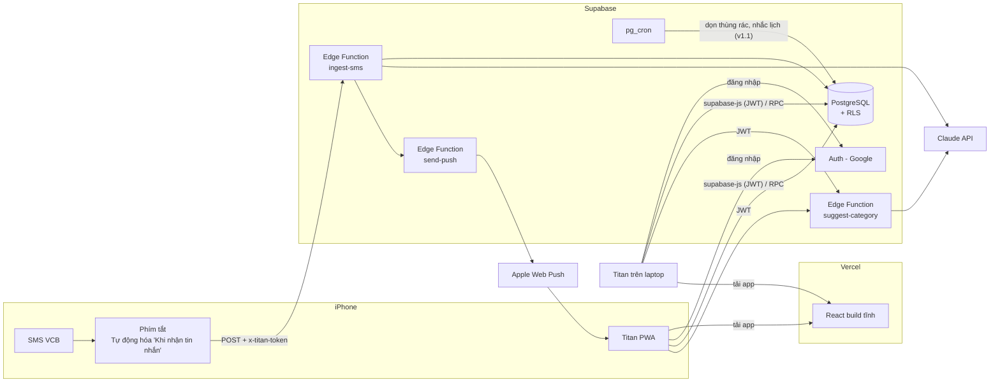
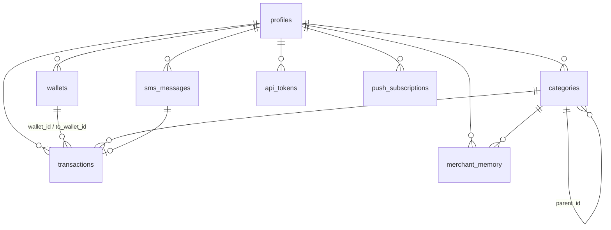

# TITAN – Kế hoạch Kỹ thuật

| | |
|---|---|
| **Phiên bản tài liệu** | 1.0 |
| **Ngày** | 06/11/2026 |
| **Dựa trên** | [01-dac-ta-nghiep-vu.md](01-dac-ta-nghiep-vu.md) (BRD v1.0) |
| **Phạm vi chi tiết** | **v1.0 – Ghi nhận tự động** (các bảng/API của v1.1+ chỉ phác thảo để thiết kế không phải đập đi làm lại) |
| **Mục tiêu thời gian** | v1.0 release sau **7 ngày** |

---

## 1. Bộ công nghệ (đã chốt)

| Lớp | Công nghệ | Ghi chú |
|---|---|---|
| Ngôn ngữ | **TypeScript** | Dùng cho cả frontend và backend |
| Frontend | **React + Vite** + `vite-plugin-pwa` | PWA cài được lên màn hình chính iPhone |
| Giao diện | **Tailwind CSS + shadcn/ui** | Tối giản, không chế độ tối |
| Gọi dữ liệu | `@supabase/supabase-js` + TanStack Query | Cache, tự refetch, trạng thái loading |
| Backend | **Supabase**: PostgreSQL · Auth (Google) · **Edge Functions** (Deno/TS) · RLS · pg_cron | Miễn phí |
| AI | **Claude API** qua SDK chính thức `@anthropic-ai/sdk`, structured output (JSON) | Chọn model: xem mục 7 |
| Thông báo | **Web Push** (VAPID) | |
| Test | **Vitest** | Ưu tiên bộ tách SMS, bộ tách ghi nhanh |
| Hosting | **Vercel** (frontend) + **Supabase Cloud** (backend) | Link `*.vercel.app` |
| Dev local | **Supabase CLI + Docker** | Docker đã có trên máy |
| Quản lý gói | **pnpm** | |

**Chi phí:** 0đ + phí SMS Banking VCB + phí Claude API (mục 7).

---

## 2. Kiến trúc hệ thống



### 2.1. Ba con đường dữ liệu đi vào hệ thống

| Đường | Ai gọi | Xác thực | Dùng cho |
|---|---|---|---|
| **A. supabase-js → PostgREST** | Web app | JWT của Supabase Auth + **RLS** | Đọc/ghi đơn giản: danh sách giao dịch, danh mục, ví |
| **B. supabase-js → RPC (Postgres function)** | Web app | JWT + RLS | Nghiệp vụ nhiều bước cần **atomic**: duyệt giao dịch + cập nhật ghi nhớ quán, xóa mềm, khôi phục, tạo token |
| **C. Edge Functions** | Phím tắt / Web app | Token riêng (`x-titan-token`) hoặc JWT | Việc cần gọi ra ngoài (Claude, Web Push) hoặc cần giữ bí mật (API key) |

**Quy tắc chọn:** dữ liệu thuần → A. Nhiều bảng phải thay đổi cùng lúc → B. Cần gọi dịch vụ ngoài hoặc dùng secret → C.

### 2.2. Vì sao Phím tắt không dùng JWT của Supabase?
JWT hết hạn sau khoảng 1 giờ, Phím tắt không tự làm mới được. Vì vậy dùng **API token dài hạn** do Titan cấp, lưu dạng **băm SHA-256** trong DB, người dùng thu hồi/tạo lại được (BR-21). Function `ingest-sms` deploy với `--no-verify-jwt` và tự kiểm tra token.

---

## 3. Thiết kế database (v1.0)

### 3.1. Quy ước
- Khóa chính `uuid` (`gen_random_uuid()`).
- **Tiền: `bigint` đơn vị đồng** (VND không có số lẻ, tránh lỗi số thực).
- Thời gian: `timestamptz`. "Một ngày" luôn tính theo múi giờ **Asia/Ho_Chi_Minh**.
- Mọi bảng dữ liệu người dùng có `user_id` + **RLS: `user_id = auth.uid()`**.
- Xóa mềm bằng `deleted_at` (thùng rác, BR-19).
- Schema quản lý bằng **migration SQL** trong `supabase/migrations/`.

### 3.2. Sơ đồ



### 3.3. Các bảng

**`profiles`** – 1-1 với `auth.users`, tạo tự động bằng trigger khi đăng nhập lần đầu.
| Cột | Kiểu | Ghi chú |
|---|---|---|
| id | uuid PK | = `auth.users.id` |
| display_name | text | |
| settings | jsonb | giờ tổng kết, giờ yên lặng, giọng điệu AI, ẩn số dư... (mở rộng không cần migration) |
| onboarded_at | timestamptz | null = chưa thiết lập ban đầu |
| created_at | timestamptz | |

**`wallets`**
| Cột | Kiểu | Ghi chú |
|---|---|---|
| id, user_id | | |
| name | text | "VCB", "Tiền mặt" |
| kind | enum `wallet_kind` (`bank`, `cash`) | |
| opening_balance | bigint | số dư lúc bắt đầu dùng app |
| is_default_manual | bool | ví mặc định khi ghi nhanh (Tiền mặt) |
| created_at, archived_at | | |

**`categories`**
| Cột | Kiểu | Ghi chú |
|---|---|---|
| id, user_id | | |
| parent_id | uuid null | null = danh mục cấp 1 |
| kind | enum `category_kind` (`expense`, `income`) | |
| name, icon | text | |
| sort_order | int | |
| system_key | text null | đánh dấu danh mục hệ thống, ví dụ `unknown` = "Chi tiêu không rõ" (không cho xóa) |
| hidden_at | timestamptz null | ẩn thay vì xóa (giữ lịch sử) |

Bộ danh mục mặc định (BRD 5.4) được **seed bằng trigger** khi tạo profile.

**`transactions`** – bảng trung tâm
| Cột | Kiểu | Ghi chú |
|---|---|---|
| id, user_id | | |
| type | enum `txn_type` | xem bảng dưới |
| amount | bigint, `CHECK (amount > 0)` | BR-01 |
| occurred_at | timestamptz | thời điểm phát sinh (từ SMS nếu có, BR-07) |
| wallet_id | uuid null | null chỉ khi `type = borrow` (BR-03) |
| to_wallet_id | uuid null | chỉ dùng cho `transfer` |
| category_id | uuid null | bắt buộc với expense/income/borrow khi đã duyệt |
| status | enum (`pending`, `confirmed`) | |
| source | enum (`sms`, `manual`, `reconcile`, `system`) | |
| description | text | "Bánh mì", hoặc nội dung CK đã rút gọn |
| merchant | text null | tên quán đã chuẩn hóa (dùng cho ghi nhớ quán) |
| note | text null | |
| tags | text[] | |
| mood | enum null (`worth`, `neutral`, `regret`) | |
| ai_confidence | real null | 0–1 |
| ai_alternatives | jsonb null | 2 gợi ý khi quán nhiều danh mục (BR-15) |
| sms_message_id | uuid null | |
| counterparty | text null | v1.0 lưu tên tạm; v1.2 chuyển sang bảng `contacts` |
| created_at, updated_at, deleted_at | | |

**Ánh xạ 6 loại nghiệp vụ → `txn_type`:**
| Loại nghiệp vụ (BRD) | `txn_type` | Ví |
|---|---|---|
| Chi | `expense` | `wallet_id` − |
| Thu | `income` | `wallet_id` + |
| Chuyển nội bộ | `transfer` | `wallet_id` −, `to_wallet_id` + |
| Được trả hộ | `borrow` | không đổi |
| Cho vay / Ứng tiền | `lend` | `wallet_id` − |
| Trả nợ / Thu nợ | `repay` / `collect` | − / + |

> v1.0 cho phép tạo mọi loại (để duyệt SMS "vuốt lên" chọn được), nhưng **sổ nợ đầy đủ** (bảng `debts`, khớp tự động) làm ở v1.2.

**`sms_messages`** – lưu mọi SMS nhận được (kể cả lỗi) để truy vết và chống trùng
| Cột | Kiểu | Ghi chú |
|---|---|---|
| id, user_id | | |
| body_masked | text | nội dung đã **che số tài khoản** (BR-22) |
| sender | text null | |
| received_at | timestamptz | lúc server nhận |
| dedupe_key | text, `UNIQUE (user_id, dedupe_key)` | băm của nội dung chuẩn hóa (BR-06) |
| parse_status | enum (`parsed`, `failed`, `ignored`) | `ignored` = không phải SMS biến động số dư (OTP, quảng cáo) |
| parsed | jsonb | kết quả tách: số tiền, dấu, thời gian, số dư, nội dung |
| parser_version | text | để biết SMS cũ tách bằng phiên bản nào khi VCB đổi định dạng |
| balance_after | bigint null | dùng cho BR-08 |
| error | text null | |

**`merchant_memory`** – ghi nhớ quán (BR-14, BR-15)
| Cột | Kiểu | Ghi chú |
|---|---|---|
| user_id, keyword, category_id | PK gộp | `keyword` đã chuẩn hóa: bỏ dấu, viết thường, bỏ số |
| hits | int | số lần người dùng xác nhận |
| last_used_at | timestamptz | |

**`api_tokens`**
| Cột | Kiểu | Ghi chú |
|---|---|---|
| id, user_id | | |
| token_hash | text UNIQUE | SHA-256, **không bao giờ lưu token gốc** |
| prefix | text | 6 ký tự đầu để người dùng nhận biết |
| created_at, last_used_at, revoked_at | | |

**`push_subscriptions`**
| Cột | Kiểu |
|---|---|
| id, user_id, endpoint (UNIQUE), p256dh, auth, user_agent, created_at |

**View `wallet_balances`**: số dư mỗi ví = `opening_balance` + tổng biến động các giao dịch `deleted_at IS NULL` (BR-02). Tính bằng view (không lưu cột số dư) để **không bao giờ lệch**; dữ liệu 1 người dùng rất nhỏ nên tốc độ không phải vấn đề.

**Chỉ mục:** `transactions (user_id, occurred_at DESC) WHERE deleted_at IS NULL`, `transactions (user_id, status) WHERE status = 'pending'`.

### 3.4. Phác thảo bảng cho các phiên bản sau
| Phiên bản | Bảng |
|---|---|
| v1.1 | `recurring_items`, `month_plans`, `day_results` (kết quả hạn mức ngày, hũ dư), `funds`, `fund_movements`, `cash_counts` |
| v1.2 | `contacts`, `debts`, `debt_settlements`, `quick_templates` |

---

## 4. Thiết kế API (v1.0)

### 4.1. Edge Functions

#### `POST /functions/v1/ingest-sms` ⭐
Gọi bởi Phím tắt. Header: `x-titan-token: <token>`.

Request:
```json
{ "text": "SD TK 1234567890 -35,000VND luc 06-11-2026 12:30:15. SD 1,234,567VND. Ref ... COM TAM", "sender": "Vietcombank" }
```
Response `200`:
```json
{ "status": "created", "transaction_id": "…", "summary": "-35.000đ · Ăn uống?" }
```
`status` ∈ `created` · `duplicate` (SMS đã nhận, BR-06) · `ignored` (không phải SMS biến động số dư) · `failed` (lưu SMS nhưng tách thất bại, vẫn báo người dùng).

Lỗi: `401` token sai/đã thu hồi · `400` thiếu `text` · `429` quá nhiều request.

**Luồng xử lý** (BRD P2):
1. Kiểm tra token → lấy `user_id`, cập nhật `last_used_at`.
2. Chuẩn hóa nội dung → `dedupe_key` → đã có thì trả `duplicate`.
3. **Che số tài khoản**, lưu `sms_messages`.
4. Tách SMS bằng regex (`_shared/sms/vcb.ts`) → thất bại thì `failed`.
5. So số dư trong SMS với `wallet_balances` (BR-08) → lệch thì đính cảnh báo.
6. Nhận diện: rút ATM → `transfer`; tiền vào → `income`; còn lại → `expense`.
7. Gợi ý danh mục: ghi nhớ quán trước, không có mới gọi Claude (chỉ gửi phần nội dung, BR-16).
8. Tạo giao dịch `pending`, gửi Web Push.

Mục tiêu: **< 3 giây** (NFR-05 cho cả chặng là < 10 giây).

#### `POST /functions/v1/suggest-category`
Gọi bởi web app khi ghi nhanh (JWT). Gom nhiều món một lần.
```json
// request
{ "items": [ { "description": "bánh mì", "amount": 20000 }, { "description": "trà sữa", "amount": 45000 } ] }
// response
{ "items": [ { "category_id": "…", "confidence": 0.95, "alternatives": [] }, … ] }
```

#### `send-push` (nội bộ)
Module dùng chung trong `_shared/push.ts`, được `ingest-sms` gọi trực tiếp; sau này pg_cron gọi qua `pg_net` để gửi nhắc lịch.

### 4.2. RPC (Postgres functions, gọi bằng `supabase.rpc()`)
| Hàm | Việc |
|---|---|
| `confirm_transaction(id, patch jsonb)` | Duyệt (kèm sửa nếu có) + **upsert `merchant_memory`** trong cùng transaction |
| `soft_delete_transaction(id)` / `restore_transaction(id)` | Thùng rác |
| `complete_onboarding(vcb_balance, cash_balance)` | Đặt số dư ban đầu, đánh dấu `onboarded_at` |
| `rotate_api_token()` | Thu hồi token cũ, tạo token mới, **trả token gốc đúng 1 lần** |

Mọi hàm `SECURITY INVOKER` (chạy dưới quyền người dùng, RLS vẫn áp dụng).

### 4.3. PostgREST trực tiếp (supabase-js)
`transactions` (list có lọc + phân trang, insert khi ghi nhanh, update), `categories` (CRUD), `wallets` (đọc), `wallet_balances` (đọc), `push_subscriptions` (insert/delete của chính mình).

### 4.4. pg_cron (v1.0)
| Lịch | Việc |
|---|---|
| 03:00 hằng ngày | Xóa vĩnh viễn giao dịch trong thùng rác quá 30 ngày (BR-19) |

---

## 5. Hai bộ tách (parser) – trái tim của v1.0

Cả hai là **hàm thuần** (không gọi mạng, không đụng DB) → test bằng Vitest rất dễ, chạy được ở cả trình duyệt lẫn Edge Function.

### 5.1. Bộ tách SMS VCB – `supabase/functions/_shared/sms/`
- `parseVcbSms(text) → { sign, amount, occurredAt, balanceAfter, content } | null`
- `maskAccountNumbers(text)`
- `normalizeMerchant(content)` → keyword cho ghi nhớ quán
- `detectAtmWithdrawal(parsed)`
- **Cần mẫu SMS thật** (BRD Q1). Mỗi mẫu SMS thật trở thành một test case.

### 5.2. Bộ tách ghi nhanh – `supabase/functions/_shared/quick-entry/`
- `parseQuickEntry(input, now) → { date, walletHint, type, counterparty, items: [{ description, amount }] }`
- `parseMoney("1tr2") → 1200000`
- Lệnh v1.0: `/hôm qua`, `/ngày dd/mm`, `/vcb`, `/thu`, `@tên` (v1.0 chỉ ghi `counterparty`), kết hợp nhiều lệnh.
- Web app import qua alias `@shared` → **dùng chung một mã nguồn**.

---

## 6. Cấu trúc repo

```
titan/
├── apps/
│   └── web/                      # React + Vite PWA
│       ├── src/
│       │   ├── features/         # home, quick-entry, review, transactions, settings, onboarding
│       │   ├── components/ui/    # shadcn/ui
│       │   ├── lib/              # supabase client, query client, format tiền/ngày
│       │   └── sw/               # service worker: cache + nhận push
│       └── vite.config.ts
├── supabase/
│   ├── config.toml
│   ├── migrations/               # schema, RLS, functions, seed danh mục, cron
│   ├── functions/
│   │   ├── _shared/              # sms/, quick-entry/, ai/, push/, auth-token.ts (+ *.test.ts)
│   │   ├── ingest-sms/
│   │   └── suggest-category/
│   └── seed.sql                  # dữ liệu mẫu cho dev local
├── shortcuts/                    # hướng dẫn cài Phím tắt iPhone (ảnh + các bước)
├── docs/                         # BRD, kế hoạch kỹ thuật, ghi chú phát hành
├── .github/workflows/ci.yml
├── package.json                  # pnpm workspace + script chung
└── README.md
```

---

## 7. Chọn model Claude

> ✅ **Đã chốt (06/11/2026): Claude Haiku 5.5 (`claude-haiku-5-5`)**, đặt qua biến môi trường `TITAN_AI_MODEL`.
>
> 🔄 **Cập nhật 07/11/2026: AI tạm TẮT** (chưa nạp credit). Gợi ý danh mục chạy theo thứ tự **ghi nhớ quán → từ điển từ khóa** (`_shared/keyword-rules.ts`, miễn phí). Khi đặt secret `ANTHROPIC_API_KEY`, AI tự bật làm bước thứ 3 cho khoản chưa có gợi ý — không cần sửa code hay deploy lại.
>
> 🔄 **Nguồn tự động chính: email biên lai VCB** qua Google Apps Script (`integrations/gmail-apps-script/`, hướng dẫn docs/04). Endpoint `ingest-sms` nhận cả SMS lẫn email (`_shared/incoming.ts` chọn bộ tách).

Tác vụ: **phân loại một dòng nội dung ngắn** vào danh mục → trả JSON (structured output qua `output_config.format`). Chỉ gọi khi **ghi nhớ quán không có**, nên số lần gọi giảm dần theo thời gian.

Ước tính: ~50 lần/ngày × 30 = **1.500 lần/tháng**, mỗi lần ~600 token vào, ~50 token ra (+ token suy nghĩ của model).

| Model | Giá (USD / 1 triệu token, vào / ra) | Ước tính / tháng |
|---|---|---|
| **Claude Opus 5.5** (`claude-opus-5-5`) – mạnh nhất dòng Opus, mặc định | $4 / $20 | ~5–8 USD (~130–210k đ) |
| **Claude Haiku 5.5** (`claude-haiku-5-5`) – nhỏ, nhanh | $0.10 / $0.50 | ~0.3 USD (~8k đ) |

Số ước tính, sẽ đo thật từ `usage` của API sau tuần đầu. Model được đặt bằng **biến môi trường** nên đổi lúc nào cũng được, không cần sửa code.

---

## 8. Quy trình làm việc

### 8.1. Môi trường
| Môi trường | Frontend | Backend | Dùng cho |
|---|---|---|---|
| **Local** | `pnpm dev` (localhost) | Supabase CLI + Docker | Viết code, test |
| **Production** | Vercel | Supabase Cloud project `titan` | Dùng thật hằng ngày |

Bí mật (không bao giờ commit): `ANTHROPIC_API_KEY`, `VAPID_PRIVATE_KEY` → **Supabase secrets**. Frontend chỉ có `VITE_SUPABASE_URL`, `VITE_SUPABASE_PUBLISHABLE_KEY`, `VITE_VAPID_PUBLIC_KEY` (công khai được). File `.env.example` liệt kê đủ tên biến.

### 8.2. Git & GitHub (giống Omninary)
| Remote | Repo | Nội dung | Khi nào push |
|---|---|---|---|
| `workspace` | `DiTan1606/Titan-workspace` (private) | Toàn bộ lịch sử commit chi tiết, tài liệu | Mỗi ngày / mỗi tính năng |
| `public` | `DiTan1606/Titan` | Bản công bố, **1 commit mỗi phiên bản** (ví dụ "Titan 1.0") | Mỗi lần release |

- Commit theo **Conventional Commits**: `feat:`, `fix:`, `docs:`, `test:`, `chore:`, `refactor:`.
- **Tác giả commit: tài khoản GitHub của chủ dự án, không có dòng Co-Authored-By / Generated with Claude.**
- Nhánh: làm trên `main`, tính năng lớn tách nhánh `feature/...` rồi merge.
- Release: tag `v1.0.0`, ghi chú phát hành trong `docs/releases/`.
- Vercel nối với repo `Titan-workspace` → push lên `main` là tự deploy.

### 8.3. CI (GitHub Actions)
Mỗi lần push: `pnpm install` → `typecheck` → `lint` → `test` (Vitest). Đỏ thì không deploy.

---

## 9. Chiến lược test

| Tầng | Công cụ | Test gì | Mức |
|---|---|---|---|
| **Unit** | Vitest | Bộ tách SMS (mọi mẫu SMS thật), bộ tách ghi nhanh, `parseMoney`, che số TK, chuẩn hóa tên quán | **Bắt buộc**, phủ kín – sai ở đây là ghi sai tiền |
| **Database** | Script SQL chạy trên Supabase local | RLS: người A không đọc được dữ liệu người B; `wallet_balances` đúng với từng loại giao dịch | Bắt buộc |
| **Tích hợp** | Gọi `ingest-sms` local bằng script | Token sai → 401, SMS trùng → duplicate, SMS ATM → transfer | Bắt buộc |
| **Thủ công E2E** | iPhone thật | Checklist: cài PWA, đăng nhập, nhận SMS thật → thông báo → vuốt duyệt, ghi nhanh, thùng rác | Trước mỗi release |

---

## 10. Kế hoạch 7 ngày (v1.0)

| Ngày | Việc | Xong khi |
|---|---|---|
| **1** | Cài pnpm, gh, Supabase CLI · Dựng monorepo · Tạo 2 repo GitHub · Supabase local + cloud · Migration: `profiles`, `wallets`, `categories` + seed + RLS · Đăng nhập Google · Deploy Vercel · **Thử Web Push trên iPhone** (rủi ro lớn nhất về kỹ thuật) | Đăng nhập được trên iPhone qua link `vercel.app`, nhận được 1 thông báo thử |
| **2** | Migration: `transactions`, `sms_messages`, `api_tokens`, `wallet_balances` · Bộ tách SMS + test · `ingest-sms` (token, chống trùng, che số TK, ATM) | Gửi SMS mẫu bằng curl → ra giao dịch đúng |
| **3** | `merchant_memory` + RPC `confirm_transaction` · Gọi Claude phân loại · `suggest-category` · Thùng rác + cron | Backend v1.0 đủ, test xanh |
| **4** | Giao diện: onboarding, màn hình chính (số dư, chi hôm nay, chờ duyệt) · Ghi nhanh: bộ tách + lệnh `/`, `@` + hàng nút chọn nhanh + xem trước | Ghi tiền mặt được trên điện thoại |
| **5** | Giao diện: duyệt vuốt thẻ (phải/trái/lên), danh sách giao dịch, sửa, thùng rác, cài đặt (token, thông báo) · PWA manifest + icon | Dùng trọn vòng trên web |
| **6** | Cài Phím tắt trên iPhone + viết hướng dẫn · **Test bằng SMS thật** · Sửa lỗi · Checklist E2E | Một ngày dùng thật không lỗi |
| **7** | Rà soát bảo mật (RLS, token, secrets) · README · Ghi chú phát hành · Tag `v1.0.0` · Push `public` | **Release Titan 1.0** 🎉 |

---

## 11. Rủi ro kỹ thuật

| Rủi ro | Giảm thiểu |
|---|---|
| Web Push trên iOS PWA khó cấu hình / thư viện web-push chạy không ổn trên Deno | Thử ngay **ngày 1**. Phương án dự phòng: gửi push từ một hàm Node nhỏ trên Vercel |
| Chưa có mẫu SMS thật ở ngày 2 | Viết bộ tách theo mẫu giả định, thiết kế để thêm mẫu thật dễ dàng, chỉnh lại ở ngày 6 |
| Phím tắt "Khi nhận tin nhắn" lọc người gửi không chính xác | Lọc thêm ở server (`ignored` cho SMS không phải biến động số dư) |
| Supabase free tạm dừng khi không hoạt động 1 tuần | Dùng hằng ngày nên không xảy ra; cảnh báo trong README |
| 1 tuần quá gấp | Cắt theo thứ tự: chế độ "vuốt lên" → `suggest-category` cho ghi nhanh → lệnh `/ngày`. **Không cắt** luồng SMS → duyệt |
